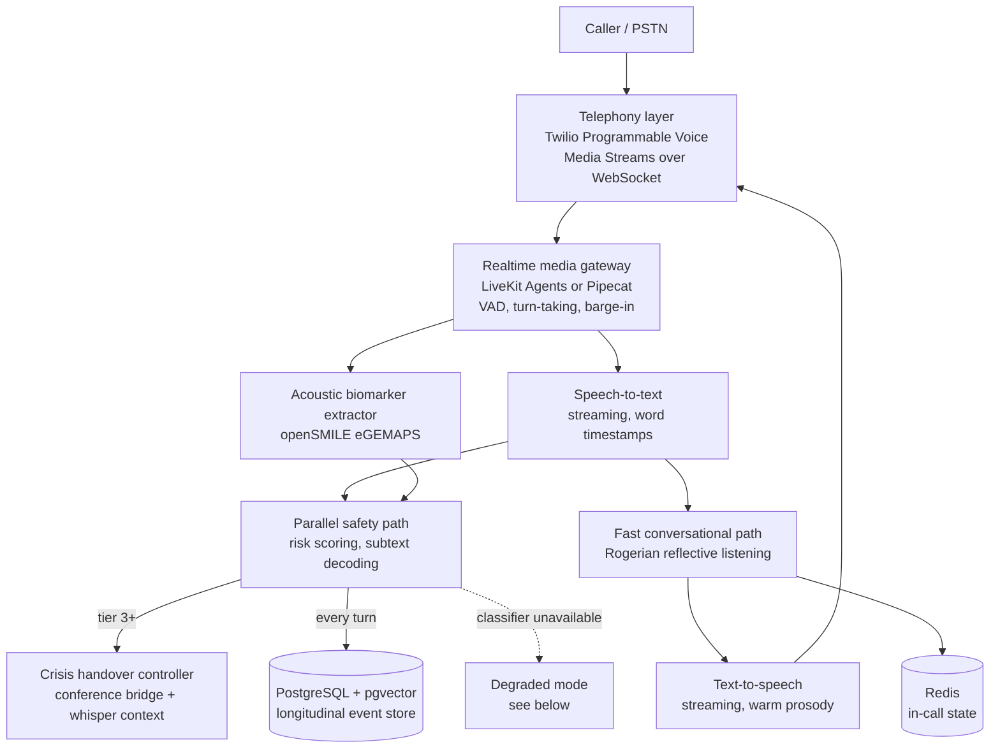

# Architecture

Consolidated 2026-10-14 from `comprehensive_implementation_plan.md` and `mental_health_voice_agent_blueprint.md`. Nothing described here is implemented. Every component is marked Planned; where a design claim could not be verified it is marked Unverified and cross-referenced to `docs/risks.md`.

## The core idea

HelpHuman is a real-time voice pipeline with a deliberate split: the model that talks to the caller is not the model that assesses their risk.

The conversational path optimizes for warmth and latency. The safety path runs in parallel on the same transcript, scores risk independently, and has no stake in keeping the conversation pleasant. Because it never sees the conversational system prompt and holds no conversational history, nothing a caller says to the chat model can suppress its score. This is the strongest idea in the planning documents and should survive implementation unchanged.

A third branch extracts acoustic features from raw audio, feeding the safety path signals that language alone does not carry — pitch flattening, psychomotor slowing, lengthening pauses.

## System diagram

## Components

| Layer | Intended technology | Status | Notes |
| :--- | :--- | :--- | :--- |
| Telephony and carrier | Twilio Voice; Telnyx as alternative | Planned | HIPAA eligibility of Media Streams is unsettled — `docs/risks.md` item 5. |
| Realtime media gateway | LiveKit Agents or Pipecat | Planned, undecided | Decide before Phase 1; switching later requires rework — item 9. |
| Speech-to-text | Deepgram Nova-2 streaming; Whisper Large v3 Turbo self-hosted as fallback | Planned | Documented latency targets (~120–160 ms) are vendor claims, unmeasured here. |
| Conversational core | `claude-sonnet-5-5` or `claude-opus-5-5` | Planned | Documents name Claude 3.5 Sonnet — stale, item 6. |
| Parallel safety classifier | `claude-haiku-5-5` as baseline; fine-tuned encoder only if measurement justifies it | Planned | Documents specify fine-tuned DeBERTa-v3-large — see item 6 for why this is now a later step. |
| Acoustic biomarkers | openSMILE, eGEMAPS 88-parameter set, with a light tree ensemble | Planned | Training data access is a gate — items 3 and 4. |
| Text-to-speech | Cartesia Sonic; ElevenLabs Flash v2.5 as alternative | Planned | |
| In-call state | Redis 7.0+ | Planned | |
| Longitudinal store | PostgreSQL with pgvector | Planned | |
| Crisis handover | Twilio conference bridge to 988 or on-call clinician | Planned, mechanism unverified | The terminal safety action rests on an unconfirmed assumption — item 1. |

## Data flow

Audio arrives over PSTN and is bridged into the media gateway as bidirectional PCM. The gateway owns voice activity detection, turn-taking and barge-in; the planning documents budget under 80–100 ms of pipeline overhead for interruption handling and under 700 ms total round trip, which the acoustic design in `comprehensive_implementation_plan.md` section 6 argues is the threshold at which conversation feels human.

Each finalized transcript turn fans out to both paths. The conversational path streams tokens into TTS so speech begins before the full response exists. The safety path scores the turn against the C-SSRS tier ladder, combines it with the current acoustic feature window, and writes a structured psychological event to the longitudinal store. The event schema in `mental_health_voice_agent_blueprint.md` section 3 is the right shape: it stores extracted intent and risk signals alongside the transcript rather than storing text alone, which is what makes longitudinal comparison against a caller's own baseline possible.

Raw audio is held in memory for feature extraction and discarded. Caller phone numbers are salted and hashed before storage.

## Degraded mode — the gap the source documents leave open

Neither planning document says what happens when the safety classifier fails. Timeouts, rate limits, refusals and outages are all routine in production, and the obvious implementation — continue the conversation, log the error — produces the worst outcome available: an agent that sounds attentive while nothing watches for risk.

Proposed behaviour, to be agreed before implementation:

The safety classifier is a required dependency. On a single turn's failure, retry once with a short timeout. On sustained failure across consecutive turns, the agent does not continue silently. It says plainly that it is having a technical problem, offers the crisis line number directly for the caller to dial themselves, and keeps the conversation going only if the caller wants it to — with the session marked unmonitored in the event store. A conversation that continues with risk monitoring disabled must be recorded as such, so the gap is visible in review rather than invisible.

The threshold for "sustained" and the exact wording are open. The principle is not: an unmonitored call must be a known state, never a silent one.

## Claude API behaviours a voice pipeline must handle

Two current behaviours bear directly on this architecture and are absent from the planning documents.

A refusal arrives as a successful response. Current Claude models return `stop_reason: "refusal"` with HTTP 200 and populate `stop_details`, rather than raising an exception. Code that reads `content` without checking `stop_reason` first will produce empty output — which on a live phone call is dead air at precisely the moment a distressed caller is waiting for a reply. Check `stop_reason` before reading content, and have a spoken fallback ready.

Forced tool use is rejected. `tool_choice` of `any` or `tool` returns a 400 on `claude-opus-5-5` and `claude-sonnet-5-5`. For a classifier that must return a parseable risk object, use structured outputs via `output_config.format`, or `tool_choice: auto` with `strict: true` on the tool.

For the conversational path, streaming is required rather than optional: latency budget aside, the SDKs require streaming for large `max_tokens` values.

## What the architecture does not yet specify

Beyond degraded mode, these remain open and should be settled during Phase 1 design rather than discovered during implementation.

Concurrency and isolation: the documents target 500 simultaneous WebSocket connections at p99 under 800 ms, but say nothing about per-call resource isolation or what happens when the gateway is saturated and a new caller dials in. A busy signal to someone in distress is a product decision, not an infrastructure one.

Consent capture: the dropped-call protocol depends on a stored callback preference gathered at session start. Where that consent lives, how it is revoked, and what the system does when it is absent are unspecified.

Clinician on-call: the escalation path references an "on-call therapist" and a "human safety team" with no definition of either. For a research protocol this is an IRB question before it is an engineering one.

Observability: there is no specification for how a reviewer inspects a past call's risk trajectory, which is the primary thing a clinical advisory board will ask for.
