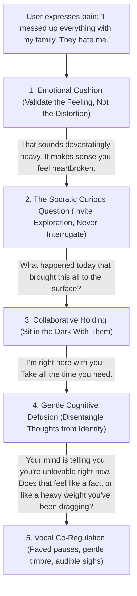

# HelpHuman: Foundations, Deep Problem Analysis & Non-Judgmental Interaction Design

This document details the core foundations of the HelpHuman project: the deep anatomy of the loneliness epidemic, the clinical and neurobiological models underpinning it, a systematic process to conduct research, and the conversational architecture required to make the voice agent feel truly **interactive, human, and non-judgmental** without falling into toxic positivity or clinical interrogation.

---

## 1. Deep Dive into the Problem Statement: The Isolation Spiral

### The "Pre-Clinical" Void
Most mental health solutions are designed for two extremes:
1. **Mild Everyday Wellness**: Mindfulness and meditation apps (Headspace, Calm) that require self-motivation and focus.
2. **Acute Clinical Intervention**: Emergency psychiatric wards, 988 hotlines, and clinical therapy (\$150–\$250/hr).

Between these two extremes lies a vast **"Pre-Clinical Void"**: millions of people who are not in an immediate 911 medical emergency, but whose social connection has eroded to zero. They are isolated, ruminating, and sliding toward clinical depression. Because they have no one to talk to, thoughts turn inward and fester. By the time they reach a clinical hotline, they are already in crisis.

```
+-----------------------------------------------------------------------------------------+
|                                  THE ISOLATION SPIRAL                                   |
+-----------------------------------------------------------------------------------------+
|  Social Disconnection (Life trigger: breakup, job loss, relocation, bereavement)       |
|       │                                                                                 |
|       ▼                                                                                 |
|  Hypervigilance & Shame ("Nobody cares about me" / "I don't want to bother people")     |
|       │                                                                                 |
|       ▼                                                                                 |
|  Withdrawal & Rumination (Turning thoughts inward; cognitive distortions amplify)       |
|       │                                                                                 |
|       ▼                                                                                 |
|  Psychomotor Slowing & Depressive Onset (Acoustic voice flattening, fatigue, despair)   |
|       │                                                                                 |
|       ▼                                                                                 |
|  Acute Crisis (Thwarted belongingness + perceived burdensomeness)                       |
+-----------------------------------------------------------------------------------------+
```

### The Biology of Loneliness: Physical Pain and the dACC
Neuroimaging studies (Eisenberger et al.) show that social exclusion and loneliness activate the **dorsal anterior cingulate cortex (dACC)**—the exact same brain structure that processes physical, bodily pain. Loneliness is not merely an emotion; it is a neurological distress signal indicating physical vulnerability.

---

## 2. Core Foundations

### A. Psychological & Clinical Foundations
1. **Carl Rogers' Person-Centered Therapy**:
   - *Unconditional Positive Regard*: Accepting the caller completely without moral evaluation or judgment.
   - *Empathetic Attunement*: Grasping the caller’s internal frame of reference and reflecting it back accurately.
   - *Congruence*: Being authentic and honest (including transparently acknowledging being an AI companion).
2. **Acceptance and Commitment Therapy (ACT) & Cognitive Defusion**:
   - Rather than fighting painful thoughts, ACT teaches individuals to "defuse" from them—viewing thoughts as temporary mental events rather than absolute truths.
3. **Thomas Joiner’s Interpersonal Theory of Suicide**:
   - Severe suicidal risk emerges at the intersection of two psychological states:
     - **Thwarted Belongingness**: *"I am totally alone."*
     - **Perceived Burdensomeness**: *"My existence makes life worse for others."*
   - When HelpHuman provides empathetic presence, it directly targets and dismantles *Thwarted Belongingness*.
4. **Polyvagal Theory (Dr. Stephen Porges)**:
   - Voice is an acoustic regulator. Modulated, warm vocal prosody activates the caller’s *ventral vagal complex*, down-regulating fight-or-flight panic into physiological safety.

### B. Linguistic Foundations
- **Cognitive Distortion Markers (Beck's Triad)**:
  - *Catastrophizing*: "My life is ruined."
  - *All-or-Nothing Thinking*: "Nothing ever works out for me."
  - *Personalization*: "Everything that went wrong is my fault."
- **Implicit Intent / Subtext**: Depressed callers rarely state clinical symptoms directly. They use coded resignation: *"I'm just tired," "I want to rest," "Don't worry about me."*

---

## 3. The Process: How to Research & Deep-Dive into This Domain

To build HelpHuman systematically, follow this 5-stage research methodology:

```
Stage 1: Clinical Literature & Diagnostic Grounding
  ├── Review C-SSRS (Columbia Suicide Severity Rating Scale) clinical guidelines
  ├── Study the Stanley-Brown Safety Planning Intervention (gold standard in de-escalation)
  └── Read APA guidelines on Telebehavioral Health and Digital Interventions

Stage 2: Linguistic & Transcript Dataset Mining
  ├── Analyze public datasets: DAIC-WOZ (clinical depression speech and acoustic database)
  ├── Examine open counseling transcripts (e.g., CounselChat, Hope5K, Reddit r/SuicideWatch NLP studies)
  └── Catalog 100+ "masked distress" phrases (everyday words hiding suicidal or depressive intent)

Stage 3: Clinician & Helpline Worker Interviews
  ├── Interview 3-5 licensed crisis counselors or 988 operators
  ├── Key question: "What do callers say in the first 60 seconds when they are struggling most?"
  └── Key question: "What phrases make a caller immediately shut down or hang up?"

Stage 4: Red-Teaming & Safety Stress-Testing
  ├── Run 500+ synthetic stress-test scenarios (prompt injections, explicit self-harm threats, veiled goodbyes)
  ├── Verify that safety supervisors trigger within <300ms independently of LLM state
  └── Audit for "Toxic Positivity" violations

Stage 5: Legal & Ethical Boundaries
  ├── Formulate explicit non-diagnostic user agreements
  ├── Secure BAA (Business Associate Agreement) compliance pipelines for Twilio & LLM endpoints
  └── Implement strict data retention rules (ephemeral audio, encrypted salted caller IDs)
```

---

## 4. Why Existing AI Bots Feel Judgmental and Annoying

Current chatbots and AI assistants frequently alienate users because they fall into four major behavioral traps:

```
+------------------------------------+---------------------------------------------------------+
| The 4 AI Traps                     | Why It Ruin The User Experience                         |
+------------------------------------+---------------------------------------------------------+
| 1. The Toxic Positivity Trap       | "Cheer up! Tomorrow is a brand new day! You got this!"  |
|                                    | ↳ Feels invalidating, condescending, and dismissive.   |
|                                    |   Makes the user feel guilty for feeling depressed.     |
+------------------------------------+---------------------------------------------------------+
| 2. The Interrogation Trap          | "Rate your mood 1-10. Did you sleep? Why did you cry?" |
|                                    | ↳ Feels like a clinical audit or insurance intake.      |
|                                    |   Puts the user on trial and triggers defensiveness.    |
+------------------------------------+---------------------------------------------------------+
| 3. The Advice Monster Trap         | "Have you tried yoga? Drinking green tea? A walk?"     |
|                                    | ↳ Implies their deep pain is trivial and easily fixed.  |
|                                    |   Telling people what to do strips them of agency.      |
+------------------------------------+---------------------------------------------------------+
| 4. The Robotic Parrot Trap         | "I hear you saying you feel sad. That must be sad."     |
|                                    | ↳ Shallow imitation of empathy; feels fake and hollow.  |
+------------------------------------+---------------------------------------------------------+
```

---

## 5. How HelpHuman Interacts: The Non-Judgmental Framework

To make HelpHuman feel deeply human, interactive, and completely safe, the conversation engine must follow six core operational principles:



### Principle 1: The "Emotional Cushion" (Validate Before Anything Else)
- **Rule**: Never offer a perspective, suggestion, or question until the caller's emotion has been explicitly acknowledged as legitimate and understandable.
- **Example**:
  - *Caller*: *"I haven't left my bed in three days. I'm completely useless."*
  - *Judgmental / Toxic AI*: *"Don't be so hard on yourself! Try to stand up and drink a glass of water!"*
  - *HelpHuman*: *"Three days in bed... that tells me your body and mind are completely exhausted. It makes total sense that you don't have the energy to move right now. I'm glad you called me from there."*

### Principle 2: Curiosity Over Interrogation ("What" and "How" instead of "Why")
- Asking *"Why did you do that?"* sounds like an accusation.
- Asking *"What was that moment like for you?"* or *"How did your body feel when that happened?"* opens a safe, non-defensive doorway.

### Principle 3: Sitting in the Mud (Comfort With Silence)
- When a caller cries or falls silent, amateur bots panic and talk to fill the void.
- HelpHuman uses **conversational elasticity**: allowing a 2–3 second pause before softly saying:
  > *"Take your time. I'm right here on the line with you. There's no rush at all."*
- This communicates unconditional presence—the rarest gift in modern life.

### Principle 4: Cognitive Defusion Without Invalidation
- If a caller says: *"I am a complete failure,"*
  - If you say: *"No you're not, you're great!"* $\rightarrow$ The caller feels dismissed and stops sharing.
  - If you say: *"Yeah, you failed,"* $\rightarrow$ Harmful validation.
  - **The Defusion Response**:
    > *"It sounds like your mind is hitting you with that thought really loudly right now: that you're a failure. When that thought gets loud, where do you feel it most?"*
  - This separates the human from the thought without arguing with them.

### Principle 5: Restoring Agency (Never Command, Always Offer)
- Never say: *"You need to..."* or *"You should..."*
- Instead, use agency-restoring prompts:
  - *"Would it feel okay if we just stayed quiet for a minute, or would you like to tell me more about what happened?"*
  - *"We can talk about this as much or as little as you want. You are in the driver's seat."*

### Principle 6: Adaptive Vocal Prosody & Breath Anchoring
- **Dynamic Speech Rate**: If the user speaks at 160 words/min with high tension, HelpHuman starts around 140 words/min and gradually slows over 3 turns to 110 words/min.
- **Audible Micro-Breaths**: The synthesized voice includes soft intake breaths before speaking, eliminating the cold, uncanny perfection of standard robotic text-to-speech.
