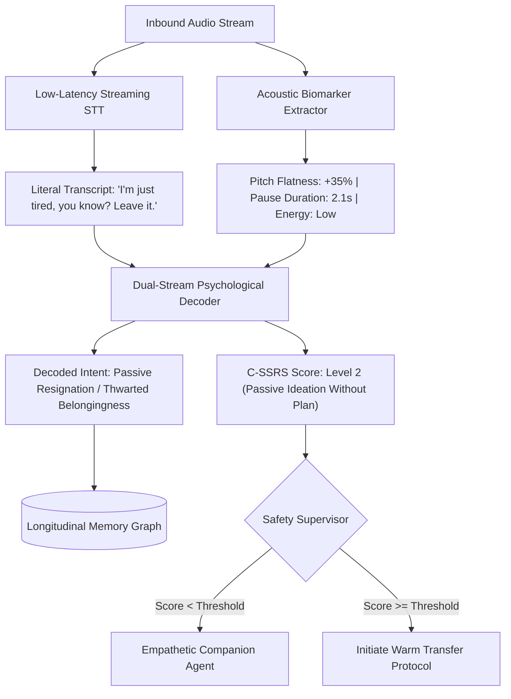
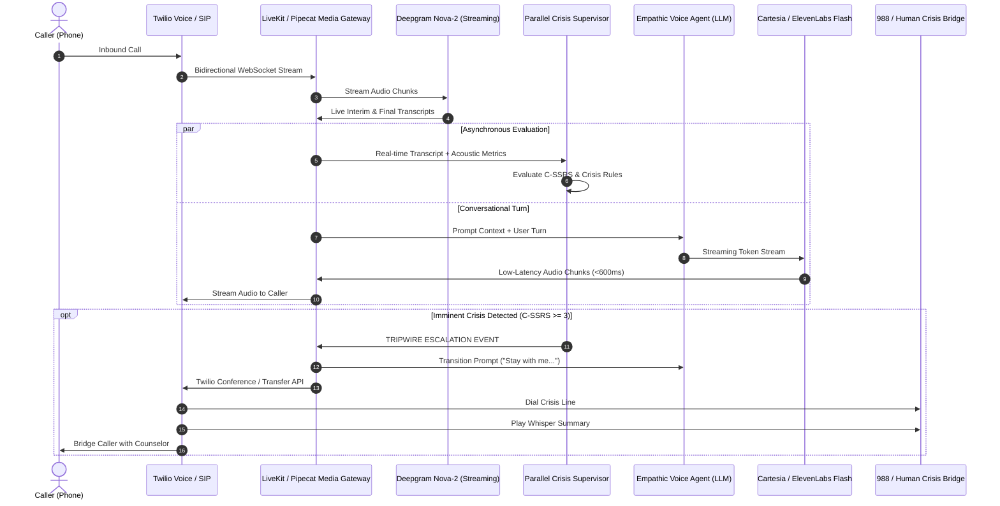
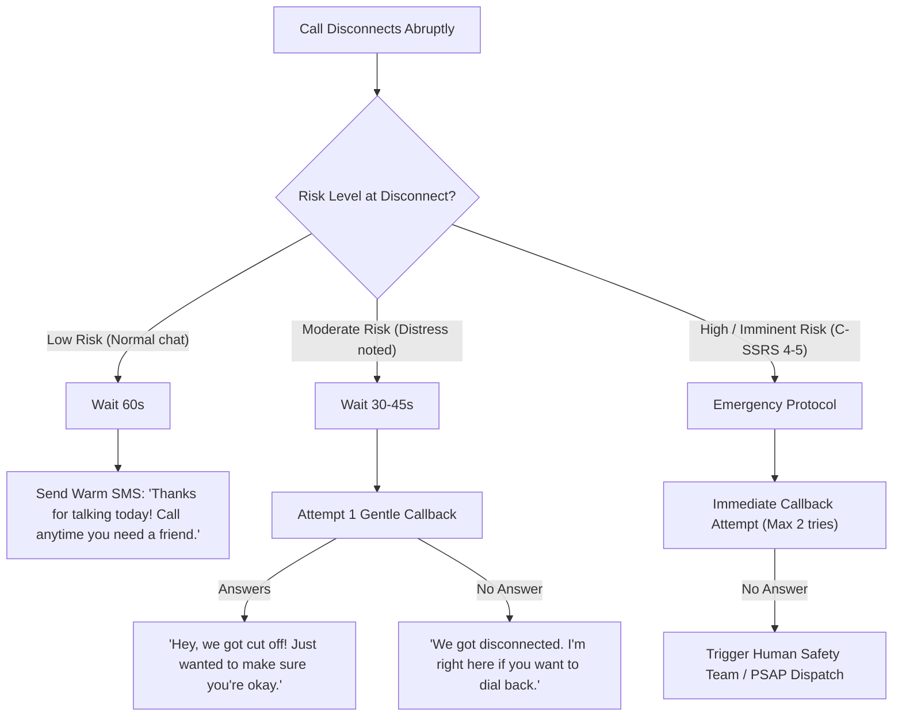

# Project Blueprint: "HelpHuman" – AI Voice Companion & Crisis Intervention Telephony System

---

## Executive Summary

**HelpHuman** is a telephony-first conversational AI agent designed to bridge the loneliness and mental health gap. It provides immediate, warm, barrier-free human-like companionship over a standard phone call, continuously analyzing both **literal speech** and **latent psychological intent** (subtext and acoustic biomarkers). 

Crucially, it acts as an **early-intervention safety net**: when distress or self-harm risks cross clinical thresholds, the agent performs a seamless, zero-friction **warm handover** to human professionals or crisis helplines (e.g., 988), equipped with a synthesized clinical context brief.

---

## 1. Problem Space & The "Why"

| Pain Point in Current Care | How Traditional Solutions Fail | How HelpHuman Solves It |
| :--- | :--- | :--- |
| **High Barrier to Entry** | Therapy costs \$150–\$250/hr, requires insurance, appointments, and weeks on waitlists. | **Zero friction**: Anyone with a basic mobile phone or landline can dial a toll-free number and talk immediately. |
| **Stigma & Reluctance** | Admitting you need "therapy" feels intimidating; people bottle up emotions until crisis. | **Framed as a companion/listener**: "Someone to talk to when nobody is around," avoiding the clinical stigma. |
| **The "Masking" Problem** | Depressed individuals often hide true feelings behind casual words ("I'm just tired"). General AI takes this literally. | **Subtext & Biomarker Engine**: Tracks acoustic prosody and latent psychological intent behind seemingly normal speech. |
| **The Escalation Chasm** | Chatbots either give canned hotline numbers (which users ignore) or hallucinate unqualified medical advice. | **Active Telephony Bridge**: Doesn't tell the caller to hang up and call 988; it puts them on a warm bridge, whispers context to the human counselor, and stays with them. |
| **Abrupt Disconnections** | If a struggling caller drops off or hangs up, current systems discard the session. | **Context-Aware Callback Engine**: Differentiates accidental drops from high-risk crisis hang-ups, with safety-aware callback protocols. |

---

## 2. Competitive Landscape & Market Differentiation

```mermaid
quadrantChart
    title Competitive Landscape: Accessibility vs. Clinical Depth
    x-axis Low Clinical Safety --> High Clinical Safety & Safety-Net
    y-axis App / Screen Based --> Telephony / Voice Direct Access
    quadrant-1 Telephony-First Clinical Safety Net (HelpHuman)
    quadrant-2 Voice Apps / Companions (Sonia, Replika)
    quadrant-3 Text Chatbots (Wysa, Woebot)
    quadrant-4 Enterprise Clinical Triage (Limbic, Hippocratic)
    "Woebot": [0.45, 0.25]
    "Wysa": [0.50, 0.20]
    "Replika": [0.20, 0.65]
    "Sonia AI": [0.60, 0.40]
    "Slingshot (Ash)": [0.65, 0.45]
    "Limbic": [0.85, 0.15]
    "HelpHuman": [0.90, 0.85]
```

### Analysis of Existing Players:
1. **Sonia AI / Slingshot (Ash)**:
   - *Strengths*: Voice-driven therapy sessions utilizing CBT principles; dedicated psychology foundation models.
   - *Weaknesses*: App-based (requires smartphone, download, visual onboarding, account creation). If a user hangs up or is in crisis, app-based routing is clumsy.
2. **Limbic**:
   - *Strengths*: Medically certified (UK Class IIa), integrated with the NHS for clinical intake and triage.
   - *Weaknesses*: Enterprise B2B tool for healthcare systems, not an accessible consumer-facing late-night phone line.
3. **Telephony Voice AI Bots (Retell, Vapi, Bland AI)**:
   - *Strengths*: Great phone latency, WebRTC/SIP integration.
   - *Weaknesses*: Built for outbound sales and customer service. They lack psychological safeguards, psychomotor speech biomarker analysis, and clinical escalation flows.

### HelpHuman’s Core Differentiators:
- **Telephony-Native (Dial from anywhere)**: No app store, no signup form, no screen glare at 3:00 AM.
- **Dual-Stream Latent Intent Extraction**: Stores not just *what* was said, but the *underlying psychological schema* (hopelessness, perceived burdensomeness, thwarted belongingness).
- **Longitudinal Acoustic Digital Phenotyping**: Compares vocal pitch variability, speech latency, and pause duration against the caller's historical baseline.
- **Warm Handover with "Whisper Brief"**: Transfers the call directly to a crisis counselor while giving the counselor a 10-second summary so the caller doesn't have to repeat their trauma.

---

## 3. The Clinical & Intent Engine: Decoding Hidden Cues

Depression manifests linguistically and acoustically in distinct ways documented in psychiatric literature (e.g., Joiner's Interpersonal Theory of Suicide, Beck's Cognitive Triad).



### 1. Linguistic Subtext Signatures in Depression
- **Absolutist Words**: Overuse of "always", "never", "completely", "nothing", "nowhere" reflects black-and-white cognitive distortions.
- **First-Person Singular Pronouns**: Heavy bias toward "I", "me", "my" indicates high internal self-rumination and isolation.
- **Perceived Burdensomeness**: "Everyone's life would be smoother without me around" $\rightarrow$ High-risk suicidal cognitive marker.
- **Thwarted Belongingness**: "Nobody really cares if I speak or not" $\rightarrow$ Severe loneliness indicator.
- **Veiled Resignation**: "I'm going to sleep for a very long time" or "Make sure my sister gets my dog" $\rightarrow$ Emergency tripwire.

### 2. Acoustic Biomarkers
- **F0 Pitch Variability**: Depressed individuals exhibit flattened vocal intonation (monotonic voice).
- **Speech Rate & Latency**: Psychomotor slowing leads to longer gaps between turns (>1.8s) and slower syllables per second.
- **Spectral Energy Decay & Breathiness**: Exhaustion and low arousal reflect in acoustic formants (F1/F2 frequency shifts).

### 3. The Data Schema: Intent Storage
Instead of storing just raw text, the caller's timeline stores structured psychological event tuples:

```json
{
  "timestamp": "2026-10-13T12:05:00Z",
  "call_id": "call_abc123",
  "caller_hash": "e3b0c44298fc1c149afbf4c8996fb92427ae41e4649b934ca495991b7852b855",
  "turn_index": 4,
  "raw_transcript": "I guess it doesn't matter anyway. I'm just gonna go to sleep.",
  "acoustic_features": {
    "pitch_variance_hz": 12.4,
    "pause_duration_ms": 2300,
    "vocal_energy_db": -24.1,
    "prosody_affect": "flat_depressive"
  },
  "extracted_intent": {
    "primary_sentiment": "hopelessness",
    "cognitive_distortion": "minimization_and_resignation",
    "underlying_need": "longing_for_validation_and_safety",
    "risk_signals": {
      "suicidal_ideation_type": "passive_wish_to_die",
      "c_ssrs_level": 2,
      "urgency_score": 0.68
    }
  }
}
```

---

## 4. System Architecture & Technical Stack



### Component Breakdown

| Layer | Recommended Technology | Why Chosen |
| :--- | :--- | :--- |
| **Telephony & Carrier** | **Twilio Voice** / **Telnyx** | Global DID phone numbers, SIP trunking, bidirectional WebSocket Media Streams, Programmable Voice Conferencing. |
| **Realtime Media Gateway** | **LiveKit Agents** or **Pipecat** | Open-source, WebRTC-native, full-duplex turn-taking, barge-in (interruption handling) with <100ms pipeline overhead. |
| **Speech-to-Text (STT)** | **Deepgram Nova-2** (Streaming) | Word error rate <8%, streaming latency ~150ms, built-in sentiment and acoustic pause detection. |
| **Out-of-Band Safety Evaluator** | **Fast Classifier / Mini LLM** (e.g. Gemini 2.0 Flash / fine-tuned BERT) | Runs parallel to conversational LLM. Unaffected by conversational context or prompt injection; dedicated to C-SSRS classification. |
| **Conversational Core** | **Claude 3.5 Sonnet** / **Gemini 2.0 Flash** / **GPT-4o** | Tuned via system prompt for reflective listening, non-directive Rogerian therapy techniques, warm validation, and open questions. |
| **Text-to-Speech (TTS)** | **Cartesia Sonic** or **ElevenLabs Flash v2.5** | Latency <120ms, hyper-realistic human pacing, natural breathing sounds, warm compassionate voice timbre. |
| **Memory & Intent Store** | **PostgreSQL (pgvector)** + **Redis** | Redis for in-call state; pgvector for caller history, acoustic baselines, and semantic intent matching. |

---

## 5. Crisis Escalation & Warm Handover Workflow

### The Columbia-Suicide Severity Rating Scale (C-SSRS) Alignment

```
Level 1: Wish to be dead ("I wish I wouldn't wake up")
   ↳ AI Action: Empathetic validation, explore support system, offer resources gently.
Level 2: Active Suicidal Ideation without method ("I want to end it all")
   ↳ AI Action: Direct safety check, prompt gentle de-escalation, ask permission to connect with someone.
Level 3: Active Ideation with any methods (not specific plan)
   ↳ AI Action: Pre-escalation; prepare warm bridge.
Level 4: Active Ideation with specific plan and intent
   ↳ AI Action: IMMEDIATE WARM TRANSFER. AI stays on line until human joins.
Level 5: Active attempt in progress or imminent intent
   ↳ AI Action: IMMEDIATE EMERGENCY ROUTING (911 / Mobile Crisis / 988 Lifeline).
```

### How the Warm Transfer Works Technically:
1. **Calming Bridge Phrase**: The AI doesn't abruptly transfer. It speaks warmly:
   > *"I hear how much pain you're carrying right now, and you don't have to carry this alone. I want to bring someone into our conversation who specializes in helping people through this exact feeling. I'm going to stay right here with you while we connect."*
2. **Move to Twilio Conference Room**:
   - The user is placed in a conference room with soft ambient tones (no harsh hold beeps).
3. **Outbound Dial to Crisis Service**:
   - Twilio API dials the crisis line or on-call human therapist pool.
4. **Whisper Announcement to Counselor**:
   - Before connecting the two audio tracks, Twilio plays a private audio whisper to the counselor:
   > *"Incoming HelpHuman transfer. Caller has severe distress, C-SSRS Level 4. Stated: 'I have the pills on the table.' Caller identified as James, age ~30. Connecting in 3... 2... 1."*
5. **Bridge & Exit**:
   - Counselor and caller are bridged. The AI companion can offer a gentle sign-off ("I've got James on the line with Sarah now; you're in safe hands, James.") and drop off.

---

## 6. Disconnected & Dropped Call Protocol

A critical clinical dilemma: *If a depressed person hangs up, do you call them back?*



### Safety & Privacy Caveat (Domestic Violence / Shared Phones):
- Calling back a phone number can be hazardous if the caller is in an abusive household or hiding mental distress from family members.
- **Protocol**: At the start of the first session, the agent asks: *"If our call ever drops, is it safe for me to call this number back, or would you prefer a text?"* This preference is stored in the caller profile.

---

## 7. Privacy, Legal & Regulatory Framework

### 1. Transparency & Non-Deception (Crucial for Trust & Ethics)
- **Immediate Disclosure**: The agent must state within the first 15 seconds:
  > *"Hi, I'm an AI companion here to listen and talk. I'm not a licensed doctor or therapist, but I'm here for you, and we can connect to a professional anytime."*
- Decades of psychological research show that users actually *appreciate* knowing it's AI because it eliminates fear of being judged by another human.

### 2. Regulatory Positioning (Wellness vs. Medical Device)
- **SaMD (Software as a Medical Device)**: If you claim the software "diagnoses, treats, cures, or manages clinical depression," it falls under FDA 21 CFR (or EU MDR Class IIa/IIb) requiring multi-year clinical trials.
- **Supportive Listening / Companion Paradigm**: Framing the service as an **emotional support and active-listening bridge** (non-diagnostic) minimizes medical device liability while maintaining duty of care through crisis escalation.

### 3. Data Protection & HIPAA
- Zero Audio Retention for PII: Live audio streams are processed in memory and discarded.
- Only encrypted, anonymized psychological vectors and notes are retained in HIPAA-compliant, BAA-backed databases.
- Caller phone numbers are hashed with salt so internal staff cannot view raw phone numbers without emergency authorization.

---

## 8. Phased Implementation Roadmap

```
Phase 1: Proof of Concept (Weeks 1–4)
  ├── Setup Twilio number + bidirectional WebSocket stream
  ├── Integrate LiveKit Agents + Deepgram + Cartesia
  ├── Implement system prompt with Rogerian reflective listening
  └── Benchmark round-trip latency (<700ms target)

Phase 2: Intent Engine & Safety Tripwire (Weeks 5–8)
  ├── Out-of-band C-SSRS classifier
  ├── Keyword and semantic distress tripwires
  ├── Mock warm transfer to test phone line with whisper context
  └── Acoustic pause and flatness tracking

Phase 3: State & Longitudinal Tracking (Weeks 9–12)
  ├── PostgreSQL/pgvector caller timeline storage
  ├── Caller consent & safety preferences (callback vs text)
  ├── Dropped-call re-dial workflow
  └── HIPAA compliance hardening & BAA execution

Phase 4: Clinical Advisory & Pilot (Weeks 13–16)
  ├── Review system prompts with licensed clinical psychologists
  ├── Partnership integration with local or national crisis lifelines
  └── Closed beta with 50-100 supervised test callers
```

---

## Appendix: Corrections — 2026-10-14

Recorded during repository onboarding. The sections above are preserved as originally written. Full detail and sources are in [`docs/risks.md`](docs/risks.md).

### §4 Component Breakdown — stale model names

The component table names Claude 3.5 Sonnet, Gemini 2.0 Flash and GPT-4o. All three predate the current generation. For the conversational core, use `claude-sonnet-5-5` or `claude-opus-5-5`; for the out-of-band safety evaluator, `claude-haiku-5-5` is the baseline to beat before fine-tuning an encoder model.

### §5 Crisis Escalation — the warm-transfer mechanism is unverified

Two assumptions underpin this section and neither has been confirmed.

Whether 988 Lifeline centers accept a programmatic conference-bridged transfer from a third-party AI system, and accept whispered context from an automated caller, is unknown. This is the terminal action of the safety architecture; if it is not available, the escalation path has no endpoint and the design needs rework before implementation.

C-SSRS is an instrument of the Columbia Lighthouse Project. Automated scoring, and a model trained to emit C-SSRS levels, likely require licensing. The tier ladder above can be retained as an internal severity scale under a different name if permission is not granted, but the clinical validity claim cannot be.

### §6 Dropped Call Protocol — dispatch needs a human in the loop

The safety and privacy caveat on domestic violence and shared phones is the right instinct and should be kept. Two gaps remain: PSAP dispatch triggered by an AI-generated risk score is a consequential action with real potential for harm if the score is wrong, and the "human safety team" is undefined. Automated dispatch should require explicit human confirmation, and for a research protocol both the dispatch criteria and the on-call arrangement are IRB questions before they are engineering ones.

Also note: absence of a stored callback preference must be treated as no consent, not as permission.

### Gap — no defined behaviour when the safety evaluator is unavailable

The parallel safety path is the sole risk-detection mechanism, but no section specifies what happens on timeout, rate limit, refusal or outage. The natural implementation continues the conversation and silently drops monitoring, which is the worst available outcome. See the degraded-mode proposal in [`docs/architecture.md`](docs/architecture.md).
